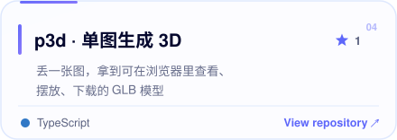
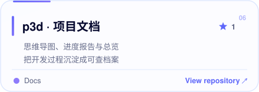
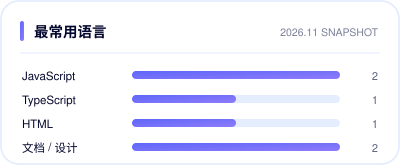
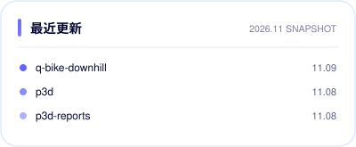

  <picture><source media="(prefers-color-scheme: dark)" srcset="assets/header-dark.svg" /></picture>

  
<b>学生开发者 · 独立做 Web 应用与工具 · 现居中国</b>

<picture><source media="(prefers-color-scheme: dark)" srcset="assets/divider-dark.svg" /></picture>

## 关于我

喜欢把脑子里的想法做成**真正能打开、能用的东西**——从界面、交互到部署，基本自己动手。

现在主要折腾三个方向：**AI + 教育**（「时光知学」历史时间轴，覆盖 13 个朝代、275 位帝王）、**Web 应用**（墨锋 InkEdge、智学 AI），以及 **3D 图形**（p3d：一张图生成可在浏览器里查看的 GLB 模型）。

> 写得慢没关系，能跑、能用、能讲清楚才算数。

<picture><source media="(prefers-color-scheme: dark)" srcset="assets/divider-dark.svg" /></picture>

  <picture><source media="(prefers-color-scheme: dark)" srcset="assets/now-dark.svg" /></picture>

<picture><source media="(prefers-color-scheme: dark)" srcset="assets/divider-dark.svg" /></picture>

## 技术栈

       

<picture><source media="(prefers-color-scheme: dark)" srcset="assets/divider-dark.svg" /></picture>

## 精选项目

<a href="https://github.com/SB763773/sgzx-overview"><picture><source media="(prefers-color-scheme: dark)" srcset="assets/card-sgzx-dark.svg" /></picture></a> <a href="https://github.com/SB763773/ink-edge"><picture><source media="(prefers-color-scheme: dark)" srcset="assets/card-ink-edge-dark.svg" /></picture></a> 
<a href="https://github.com/SB763773/zhixue-ai"><picture><source media="(prefers-color-scheme: dark)" srcset="assets/card-zhixue-ai-dark.svg" /></picture></a> <a href="https://github.com/SB763773/p3d"><picture><source media="(prefers-color-scheme: dark)" srcset="assets/card-p3d-dark.svg" /></picture></a> 
<a href="https://github.com/SB763773/q-bike-downhill"><picture><source media="(prefers-color-scheme: dark)" srcset="assets/card-q-bike-dark.svg" /></picture></a> <a href="https://github.com/SB763773/p3d-reports"><picture><source media="(prefers-color-scheme: dark)" srcset="assets/card-p3d-reports-dark.svg" /></picture></a>

「时光知学」在线站点：<a href="https://sgzx.pages.dev">sgzx.pages.dev</a>　·　全部 6 个公开仓库：<a href="https://github.com/SB763773?tab=repositories">查看列表</a>

<picture><source media="(prefers-color-scheme: dark)" srcset="assets/divider-dark.svg" /></picture>

## GitHub 数据

  <picture><source media="(prefers-color-scheme: dark)" srcset="assets/stat-overview-dark.svg" /></picture> <picture><source media="(prefers-color-scheme: dark)" srcset="assets/stat-langs-dark.svg" /></picture>  
  <picture><source media="(prefers-color-scheme: dark)" srcset="assets/stat-recent-dark.svg" /></picture>

<picture><source media="(prefers-color-scheme: dark)" srcset="assets/divider-dark.svg" /></picture>

  Built with curiosity.　·　风格来自 WorkBuddy「蓝紫 · Clear Sky（WorkBuddy 默认）」皮肤　·　更新于 2026.11

